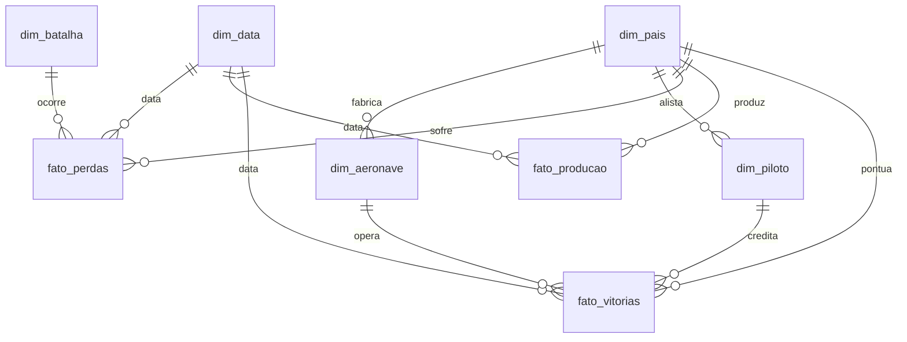

# Dicionário de Dados — Projeto Ases e Atrito

Este documento apresenta a especificação técnica completa de todas as tabelas dimensionais e de fatos do modelo dimensional em estrela (*Star Schema*).

---

## 1. Visão Geral da Modelagem

---

## 2. Tabelas Dimensionais

### 2.1 `dim_pais`
* **Descrição:** Cadastro geopolítico dos países beligerantes e coalizões.
* **Granularidade:** Uma linha por país/coalizão.
* **Chave Primária:** `id_pais`

| Coluna | Tipo SQLite | Tipo Power BI | Nulo? | Descrição | Exemplo |
| :--- | :--- | :--- | :--- | :--- | :--- |
| `id_pais` | INTEGER | Int64 | Não | Identificador único do país (PK) | `1`, `4` |
| `nome` | TEXT | Text | Não | Nome oficial padronizado em português | `"Alemanha"`, `"Estados Unidos"` |
| `lado` | TEXT | Text | Não | Aliança militar no conflito (`"Eixo"` ou `"Aliados"`) | `"Eixo"`, `"Aliados"` |

---

### 2.2 `dim_data`
* **Descrição:** Dimensão de calendário e fases cronológicas da guerra.
* **Granularidade:** Uma linha por marco temporal/data de batalha ou ano fiscal.
* **Chave Primária:** `id_data` (formato numérico YYYYMMDD)

| Coluna | Tipo SQLite | Tipo Power BI | Nulo? | Descrição | Exemplo |
| :--- | :--- | :--- | :--- | :--- | :--- |
| `id_data` | INTEGER | Int64 | Não | Chave substituta de data no formato YYYYMMDD | `19400818`, `19440101` |
| `data` | TEXT | Date | Não | Data no formato ISO (AAAA-MM-DD) | `"1940-08-18"` |
| `ano` | INTEGER | Int64 | Não | Ano do evento | `1940`, `1944` |
| `mes` | INTEGER | Int64 | Não | Mês do evento (1 a 12) | `8`, `1` |
| `fase_da_guerra` | TEXT | Text | Não | Período estratégico histórico da 2ª Guerra | `"Ponto de Inflexão (Midway, Stalingrado)"` |

---

### 2.3 `dim_batalha`
* **Descrição:** Cadastro de batalhas aéreas, campanhas de bombardeio e operações aeronavis.
* **Granularidade:** Uma linha por batalha/operação ou marco crítico.
* **Chave Primária:** `id_batalha`

| Coluna | Tipo SQLite | Tipo Power BI | Nulo? | Descrição | Exemplo |
| :--- | :--- | :--- | :--- | :--- | :--- |
| `id_batalha` | INTEGER | Int64 | Não | Identificador único da batalha (PK) | `1`, `3` |
| `nome` | TEXT | Text | Não | Nome descritivo da batalha ou fase | `"Batalha da Inglaterra - The Hardest Day"` |
| `teatro` | TEXT | Text | Não | Macrorregião geográfica operacional | `"Europa Ocidental"`, `"Pacífico Central"` |
| `data_inicio`| TEXT | Date | Não | Data de início do evento | `"1940-08-18"` |
| `data_fim` | TEXT | Date | Não | Data de término do evento | `"1940-08-18"` |

---

### 2.4 `dim_aeronave`
* **Descrição:** Catálogo técnico detalhado de variantes históricas de caças.
* **Granularidade:** Uma linha por variante específica (ex.: Bf 109E-3 ≠ Bf 109G-6).
* **Chave Primária:** `id_aeronave`
* **Chave Estrangeira:** `id_pais` -> `dim_pais(id_pais)`

| Coluna | Tipo SQLite | Tipo Power BI | Nulo? | Descrição | Exemplo |
| :--- | :--- | :--- | :--- | :--- | :--- |
| `id_aeronave` | INTEGER | Int64 | Não | Identificador único da variante (PK) | `1`, `18` |
| `modelo` | TEXT | Text | Não | Família/modelo base do avião | `"Supermarine Spitfire"`, `"Messerschmitt Bf 109"` |
| `variante` | TEXT | Text | Não | Designação exata da versão/subtipo | `"Spitfire Mk IX"`, `"Bf 109G-6"` |
| `id_pais` | INTEGER | Int64 | Não | País de origem do projeto (FK) | `5` (Reino Unido) |
| `pais` | TEXT | Text | Não | Nome do país fabricante | `"Reino Unido"` |
| `ano_entrada_servico` | INTEGER | Int64 | Não | Ano do primeiro vôo operacional com esquadrões | `1942` |
| `velocidade_max_kmh` | REAL | Decimal | Não | Velocidade máxima em voo nivelado (km/h) | `657.0` |
| `teto_operacional_m` | REAL | Decimal | Não | Altitude máxima prática de combate (metros) | `13100.0` |
| `alcance_km` | REAL | Decimal | Não | Raio/alcance operacional sem tanques extras (km) | `700.0` |
| `armamento` | TEXT | Text | Sim | Configuração de canhões, metralhadoras e bombas | `"2x Hispano 20mm + 2x .50 cal"` |
| `unidades_produzidas`| REAL | Decimal | Sim | Total histórico produzido desta variante específica | `5656.0` |
| `fonte` | TEXT | Text | Não | Origem documental primária ou URL | `"https://en.wikipedia.org/..."` |

---

### 2.5 `dim_piloto`
* **Descrição:** Cadastro biográfico de pilotos militares com 5 ou mais vitórias.
* **Granularidade:** Uma linha por piloto.
* **Chave Primária:** `id_piloto`
* **Chave Estrangeira:** `id_pais` -> `dim_pais(id_pais)`

| Coluna | Tipo SQLite | Tipo Power BI | Nulo? | Descrição | Exemplo |
| :--- | :--- | :--- | :--- | :--- | :--- |
| `id_piloto` | INTEGER | Int64 | Não | Identificador único do piloto (PK) | `1`, `109` |
| `nome_piloto` | TEXT | Text | Não | Nome completo do piloto | `"Erich Hartmann"`, `"Richard Bong"` |
| `id_pais` | INTEGER | Int64 | Não | País pelo qual o piloto combateu (FK) | `1` (Alemanha) |
| `pais` | TEXT | Text | Não | Nome do país do piloto | `"Alemanha"` |
| `forca_aerea` | TEXT | Text | Sim | Ramo militar (`Luftwaffe`, `USAAF`, `RAF`, etc.) | `"Luftwaffe"`, `"USAAF"` |
| `total_vitorias` | REAL | Decimal | Não | Número total de abates confirmados | `352.0`, `40.0` |
| `aeronave_principal` | TEXT | Text | Sim | Tipo de caça mais utilizado | `"Bf 109"`, `"P-38 Lightning"` |
| `teatro_de_operacao` | TEXT | Text | Sim | Teatro de combate predominante | `"Frente Oriental"`, `"Pacífico"` |
| `periodo_ativo` | TEXT | Text | Sim | Anos de serviço ativo durante a guerra | `"1939-1945"` |
| `fonte` | TEXT | Text | Não | Citação documental ou link da listagem | `"https://en.wikipedia.org/..."` |

---

## 3. Tabelas Fato

### 3.1 `fato_perdas`
* **Descrição:** Registro de atrito de aeronaves e abates reivindicados por evento.
* **Granularidade:** Uma linha por combinação de (batalha, data, país beligerante).
* **Chave Primária:** `id_fato_perda`

| Coluna | Tipo SQLite | Tipo Power BI | Nulo? | Descrição | Exemplo |
| :--- | :--- | :--- | :--- | :--- | :--- |
| `id_fato_perda` | INTEGER | Int64 | Não | Identificador único do registro (PK) | `1` |
| `id_batalha` | INTEGER | Int64 | Não | Chave da batalha em `dim_batalha` (FK) | `1` |
| `id_data` | INTEGER | Int64 | Não | Chave temporal em `dim_data` (FK) | `19400811` |
| `id_pais` | INTEGER | Int64 | Não | Chave do país em `dim_pais` (FK) | `5` (Reino Unido) |
| `aeronaves_perdidas` | REAL | Decimal | Não | Total de aeronaves destruídas ou perdidas | `115.0` |
| `aeronaves_abatidas_reivindicadas` | REAL | Decimal | Não | Total de abates declarados por pilotos/artilheiros | `227.0` |
| `fonte` | TEXT | Text | Não | Relatórios de perdas ou arquivos militares | `"Wood & Dempster 'The Narrow Margin'"` |

---

### 3.2 `fato_producao`
* **Descrição:** Produção industrial anual e esforço operacional USAAF por teatro.
* **Granularidade:** Uma linha por país e ano civil (com dados nacionais ou de teatro).
* **Chave Primária:** `id_fato_producao`

| Coluna | Tipo SQLite | Tipo Power BI | Nulo? | Descrição | Exemplo |
| :--- | :--- | :--- | :--- | :--- | :--- |
| `id_fato_producao` | INTEGER | Int64 | Não | Identificador único do registro (PK) | `1` |
| `id_pais` | INTEGER | Int64 | Não | Chave do país produtor em `dim_pais` (FK) | `4` (Estados Unidos) |
| `id_data` | INTEGER | Int64 | Não | Chave temporal do ano em `dim_data` (FK) | `19440101` |
| `teatro` | TEXT | Text | Não | Escopo (`"Total Nacional"` ou teatro de operações) | `"Total Nacional"`, `"Europa (ETO)"` |
| `unidades_produzidas` | REAL | Decimal | Sim | Volume fabril de aeronaves entregues | `96318.0` |
| `sorties` | REAL | Decimal | Sim | Decolagens operacionais de combate executadas | `655289.0` |
| `perdas_combate` | REAL | Decimal | Sim | Aeronaves perdidas diretamente em combate | `7749.0` |
| `abates_reivindicados` | REAL | Decimal | Sim | Aeronaves inimigas reportadas destruídas | `10425.0` |
| `fonte` | TEXT | Text | Não | Relatório governamental ou publicação oficial | `"AAF Statistical Digest Table 118"` |

---

### 3.3 `fato_vitorias`
* **Descrição:** Registro tabular das vitórias e categorias de cada ás da aviação.
* **Granularidade:** Uma linha por ás cadastrado.
* **Chave Primária:** `id_fato_vitoria`

| Coluna | Tipo SQLite | Tipo Power BI | Nulo? | Descrição | Exemplo |
| :--- | :--- | :--- | :--- | :--- | :--- |
| `id_fato_vitoria` | INTEGER | Int64 | Não | Identificador único da vitória (PK) | `1` |
| `id_piloto` | INTEGER | Int64 | Não | Chave do piloto em `dim_piloto` (FK) | `1` |
| `id_aeronave` | INTEGER | Int64 | Não | Chave da aeronave principal em `dim_aeronave` (FK) | `22` (Bf 109G-6) |
| `id_data` | INTEGER | Int64 | Não | Chave temporal representativa em `dim_data` (FK) | `19440101` |
| `id_pais` | INTEGER | Int64 | Não | Chave do país em `dim_pais` (FK) | `1` |
| `total_vitorias` | REAL | Decimal | Não | Quantidade de abates confirmados | `352.0` |
| `faixa_vitorias` | TEXT | Text | Não | Segmentação (`"100+ Lenda"`, `"50-99 Super As"`, etc.) | `"100+ Lenda da Aviação"` |
| `fonte` | TEXT | Text | Não | Registro oficial ou URL da Wikipedia | `"https://en.wikipedia.org/..."` |
