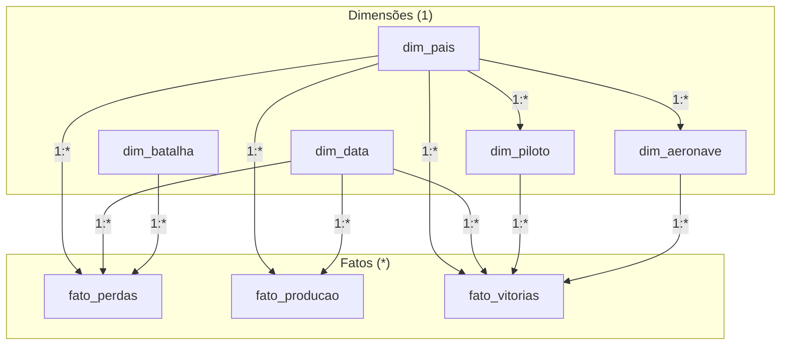

# Guia de Montagem no Power BI Desktop — Projeto Ases e Atrito

Este guia fornece o passo a passo completo para você construir o dashboard interativo no **Power BI Desktop**, desde a importação dos dados e definição das relações do modelo dimensional até o layout de cada uma das 6 páginas sugeridas.

---

## 1. Passo 1 — Importação dos Dados

Existem duas formas simples de carregar os dados no Power BI Desktop:

### Opção A (Recomendada — Via Power Query M):
1. Abra o Power BI Desktop e clique em **Transformar Dados**.
2. Abra o arquivo [`/powerquery/consultas.md`](../powerquery/consultas.md).
3. Para cada uma das 8 tabelas (`dim_pais`, `dim_data`, `dim_batalha`, `dim_aeronave`, `dim_piloto`, `fato_perdas`, `fato_producao`, `fato_vitorias`), crie uma **Consulta Nula**, abra o **Editor Avançado** e cole o código correspondente.
4. Clique em **Fechar e Aplicar**.

### Opção B (Importação Direta de CSVs):
1. No Power BI Desktop, clique em **Obter Dados** -> **Texto/CSV**.
2. Navegue até a pasta `/data/processed/` e importe os 8 arquivos CSV:
   - `dim_pais.csv`
   - `dim_data.csv`
   - `dim_batalha.csv`
   - `dim_aeronave.csv`
   - `dim_piloto.csv`
   - `fato_perdas.csv`
   - `fato_producao.csv`
   - `fato_vitorias.csv`
3. Certifique-se de que a codificação seja **65001: UTF-8**.

---

## 2. Passo 2 — Modelagem e Relacionamentos no Star Schema

Na exibição de **Modelo** do Power BI Desktop, organize as tabelas com as dimensões na parte superior e as tabelas fato na parte inferior. Crie exatamente os seguintes relacionamentos:

### Tabela de Relações e Cardinalidade

| Tabela Origem (1) | Coluna Origem | Tabela Destino (*) | Coluna Destino | Cardinalidade | Direção do Filtro |
| :--- | :--- | :--- | :--- | :--- | :--- |
| `dim_pais` | `id_pais` | `dim_aeronave` | `id_pais` | 1 para Muitos (1:*) | Única |
| `dim_pais` | `id_pais` | `dim_piloto` | `id_pais` | 1 para Muitos (1:*) | Única |
| `dim_pais` | `id_pais` | `fato_perdas` | `id_pais` | 1 para Muitos (1:*) | Única |
| `dim_pais` | `id_pais` | `fato_producao` | `id_pais` | 1 para Muitos (1:*) | Única |
| `dim_pais` | `id_pais` | `fato_vitorias` | `id_pais` | 1 para Muitos (1:*) | Única |
| `dim_data` | `id_data` | `fato_perdas` | `id_data` | 1 para Muitos (1:*) | Única |
| `dim_data` | `id_data` | `fato_producao` | `id_data` | 1 para Muitos (1:*) | Única |
| `dim_data` | `id_data` | `fato_vitorias` | `id_data` | 1 para Muitos (1:*) | Única |
| `dim_batalha` | `id_batalha` | `fato_perdas` | `id_batalha` | 1 para Muitos (1:*) | Única |
| `dim_piloto` | `id_piloto` | `fato_vitorias` | `id_piloto` | 1 para Muitos (1:*) | Única |
| `dim_aeronave` | `id_aeronave` | `fato_vitorias` | `id_aeronave` | 1 para Muitos (1:*) | Única |

> [!IMPORTANT]
> **Atenção:** Mantenha sempre a direção do filtro cruzado como **Única** (*Single*). Nunca utilize *Ambas* (*Both*) para evitar ambiguidade de propagação e queda de performance.

---

## 3. Passo 3 — Criação da Tabela de Medidas

1. Na guia **Página Inicial**, clique em **Inserir Dados**.
2. Digite o nome da tabela como `_Medidas` e clique em **Carregar**.
3. Abra o arquivo [`/dax/medidas.md`](../dax/medidas.md) e crie as medidas DAX sugeridas clicando em **Nova Medida**.

---

## 4. Passo 4 — Estrutura e Visuais das 6 Páginas do Dashboard

### Página 1: Capa / Visão Geral Executiva
* **Objetivo:** Apresentar os números globais do conflito aéreo e orientar a navegação.
* **Componentes e Visuais:**
  * **Header/Título:** "Ases e Atrito: A Guerra Aérea da 2ª GM Contada pelos Números (1939–1945)".
  * **4 Cards de KPI no Topo:**
    1. `Total Ases` (ex.: 1.020 pilotos).
    2. `Total Vitórias` (ex.: soma total de abates confirmados).
    3. `Total Produção Aeronaves` (ex.: ~730 mil aeronaves militares produzidas pelas 5 potências).
    4. `Total Sorties` (ex.: 2,36 milhões de surtidas USAAF).
  * **Gráfico de Donut / Rosca:** Distribuição de Produção por Aliança (`dim_pais[lado]`: Aliados vs. Eixo).
  * **Gráfico de Barras Empilhadas:** Total de Aeronaves Produzidas por País ao longo dos Anos.
  * **Segmentadores (Slicers):** Ano (`dim_data[ano]`) e Lado (`dim_pais[lado]`).
  * **Menu de Navegação:** Botões com marcadores (bookmarks) apontando para as páginas 2 a 6.

---

### Página 2: Hall dos Ases (Pareto & Performance Individual)
* **Objetivo:** Analisar a distribuição individual de abates e provar empiricamente a curva de Pareto.
* **Componentes e Visuais:**
  * **Gráfico de Linha e Colunas Agrupadas (Pareto):**
    * *Eixo X:* `dim_piloto[nome_piloto]` (filtrado por Top N ou maiores pontuadores).
    * *Eixo Y das Colunas:* `[Total Vitorias]` (decrescente).
    * *Eixo Y da Linha:* `[Pareto % Vitorias]` (formatado como porcentagem de 0% a 100%).
  * **Cards de Destaque (Ases Notáveis):**
    * Top 1 Mundo: Erich Hartmann (352 vitórias — Alemanha).
    * Top 1 Aliados: Ivan Kozhedub (64 vitórias — URSS).
    * Top 1 Ocidental: Richard Bong (40 vitórias — EUA).
    * Top 1 Britânico: Pat Pattle (40+ vitórias — Reino Unido).
    * Top 1 Japão: Hiroyoshi Nishizawa (87 vitórias — Japão).
  * **Matriz / Tabela Detalhada com Ícones de Posição:**
    * Colunas: `[Ranking Dinamico Ases]`, `dim_piloto[nome_piloto]`, `dim_pais[nome]`, `dim_piloto[forca_aerea]`, `dim_piloto[aeronave_principal]`, `[Total Vitorias]`.
  * **Segmentador Horizontal:** `dim_pais[nome]` e `fato_vitorias[faixa_vitorias]`.

---

### Página 3: Hangar de Aeronaves (Especificações & Evolução Técnica)
* **Objetivo:** Comparar especificações técnicas e o salto tecnológico entre variantes de caças.
* **Componentes e Visuais:**
  * **Gráfico de Dispersão (Scatter Plot / Bolhas):**
    * *Eixo X:* `dim_aeronave[ano_entrada_servico]` (Ano).
    * *Eixo Y:* `dim_aeronave[velocidade_max_kmh]` (Velocidade Máx km/h).
    * *Tamanho da Bolha:* `dim_aeronave[unidades_produzidas]`.
    * *Legenda / Cor:* `dim_aeronave[pais]`.
    * *Dica de Ferramenta (Tooltip):* Variante, Teto Operacional, Alcance e Armamento.
  * **Visual Comparativo de Variantes (Gráfico de Barras Horizontais):**
    * Evolução da família Supermarine Spitfire (Mk I até Mk 21) ou Bf 109 (E-3 até K-4).
  * **Cards de Indicadores Médios:** Velocidade Média do Eixo vs. Velocidade Média dos Aliados.
  * **Segmentador:** `dim_aeronave[modelo]` (para filtrar uma família de caças específica).

---

### Página 4: Batalhas Decisivas & O Efeito Overclaiming
* **Objetivo:** Demonstrar o fenômeno histórico da discrepância entre reivindicações e perdas reais.
* **Componentes e Visuais:**
  * **Gráfico de Colunas Clusterizadas (Lado a Lado):**
    * *Eixo X:* `dim_batalha[nome]`.
    * *Coluna 1:* `[Total Abates Reivindicados]` (cor vermelha/alerta).
    * *Coluna 2:* `[Total Aeronaves Perdidas]` (cor azul/realidade).
  * **Card de Alerta / Destaque de Discrepância:**
    * "Fator Máximo de Overclaiming: Schweinfurt (10,6x)".
    * "Battle of Britain Day: Reivindicado 185 vs Real 56 (3,3x)".
  * **Matriz Analítica:**
    * Colunas: `dim_batalha[nome]`, `dim_data[data]`, `dim_pais[nome]`, `[Total Abates Reivindicados]`, `[Total Aeronaves Perdidas]`, `[Razao Reivindicacoes vs Perdas]`.
  * **Caixa de Texto Metodológica:** Breve explicação histórica sobre o estresse de combate e o disparo simultâneo de múltiplos artilheiros.

---

### Página 5: Atrito Operacional, Produção & Esforço Industrial
* **Objetivo:** Relacionar a capacidade de produção fabril com as perdas e saídas de combate.
* **Componentes e Visuais:**
  * **Gráfico de Linhas (Evolução da Produção Militar Anual 1939-1945):**
    * *Eixo X:* `dim_data[ano]`.
    * *Eixo Y:* `[Total Producao Aeronaves]`.
    * *Legenda:* `dim_pais[nome]`. (Destaque para a explosão fabril dos EUA em 1943-1944 atingindo 96.000 aviões/ano).
  * **Gráfico de Área Empilhada (Sorties USAAF por Teatro de Operações):**
    * ETO (Europa), MTO (Mediterrâneo), FEAF (Pacífico), 20th AF (B-29s).
  * **Gráfico de Dispersão / Barras:** Taxa de Perdas em Combate vs. Sorties por Teatro.
  * **Segmentador:** Ano (`dim_data[ano]`).

---

### Página 6: Insights Estatísticos & Conclusões Históricas
* **Objetivo:** Consolidar os aprendizados estatísticos comprovados pelos dados.
* **Componentes e Visuais:**
  * **3 Blocos de Cards Informativos Formatados:**
    1. *O Mito dos Super-Homens vs. Realidade da Indústria:* A Alemanha gerou os maiores ases individuais porque não retirava veteranos de combate; os Aliados venceram por treinar turmas inteiras com instrutores de alto nível e produzir 3x mais aviões.
    2. *A Matemática do Overclaiming:* Nenhuma nação esteve imune; pilotos e artilheiros superestimavam abates de 2x a 10x sem má-fé premeditada, mas por limitações da visão em combate.
    3. *O Salto Tecnológico:* A velocidade média dos caças saltou de 530 km/h em 1939 para quase 800 km/h (e jatos a 900 km/h) em 1944-1945, a uma taxa de +27,8 km/h por ano.
  * **Tabela de Correlações Técnicas.**
  * **Miniatura das Imagens de Análise:** Importadas da pasta [`/docs/img/`](img/).

---

## 5. Dicas de Design e Paleta de Cores Recomendada

* **Tema Visual:** Militar / Documental Moderno (fundo cinza muito claro `#f8f9fa` ou escuro slate `#1e222d`).
* **Cores Semânticas:**
  * **Aliados (EUA, Reino Unido, URSS):** Azul marinho / Royal Blue (`#1f77b4` ou `#2980b9`).
  * **Eixo (Alemanha, Japão, Itália):** Vermelho escuro / Cinza aço (`#c0392b` ou `#7f8c8d`).
  * **Abates Reivindicados:** Laranja escuro / Âmbar (`#d35400`).
  * **Perdas Reais Documentadas:** Grafite / Chumbo (`#2c3e50`).
* **Tipografia:** Segoe UI ou Aptos, com números em formato tabular alinhados à direita em matrizes.
