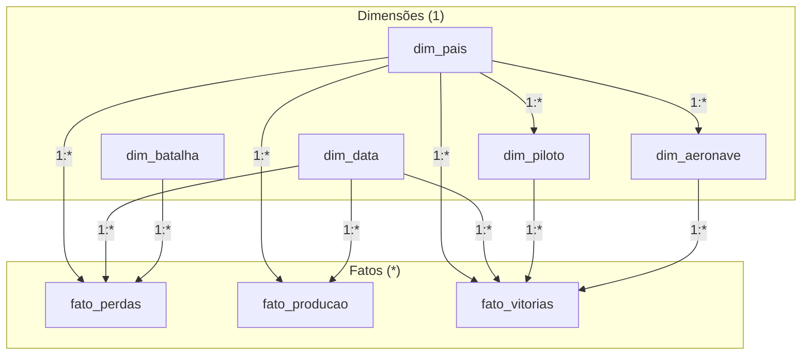

# Especificação do Dashboard Power BI — Projeto Ases e Atrito

Documento de modelagem dimensional, relacionamentos de dados e arquitetura de telas para o Power BI Desktop.

---

## 1. Modelo Dimensional (Star Schema)

### Relacionamentos e Cardinalidade

| Tabela Origem (1) | Coluna Origem | Tabela Destino (*) | Coluna Destino | Cardinalidade | Direção do Filtro |
| :--- | :--- | :--- | :--- | :--- | :--- |
| `dim_pais` | `id_pais` | `dim_aeronave` | `id_pais` | 1:* | Única (Single) |
| `dim_pais` | `id_pais` | `dim_piloto` | `id_pais` | 1:* | Única (Single) |
| `dim_pais` | `id_pais` | `fato_perdas` | `id_pais` | 1:* | Única (Single) |
| `dim_pais` | `id_pais` | `fato_producao` | `id_pais` | 1:* | Única (Single) |
| `dim_pais` | `id_pais` | `fato_vitorias` | `id_pais` | 1:* | Única (Single) |
| `dim_data` | `id_data` | `fato_perdas` | `id_data` | 1:* | Única (Single) |
| `dim_data` | `id_data` | `fato_producao` | `id_data` | 1:* | Única (Single) |
| `dim_data` | `id_data` | `fato_vitorias` | `id_data` | 1:* | Única (Single) |
| `dim_batalha` | `id_batalha` | `fato_perdas` | `id_batalha` | 1:* | Única (Single) |
| `dim_piloto` | `id_piloto` | `fato_vitorias` | `id_piloto` | 1:* | Única (Single) |
| `dim_aeronave` | `id_aeronave` | `fato_vitorias` | `id_aeronave` | 1:* | Única (Single) |

---

## 2. Estrutura e Visuais das Páginas

### Página 1: Visão Geral Executiva
- **Escopo:** Indicadores consolidados do conflito aéreo (1939–1945).
- **Cards de KPI:** `[Total Ases]`, `[Total Vitorias]`, `[Total Producao Aeronaves]`, `[Total Sorties]`.
- **Donut:** Produção por Aliança militar (`dim_pais[lado]`).
- **Barras Empilhadas:** Evolução anual da produção de aeronaves por país (`dim_data[ano]`, `dim_pais[nome]`).
- **Segmentadores:** Ano (`dim_data[ano]`) e Lado (`dim_pais[lado]`).

### Página 2: Hall dos Ases (Pareto & Performance Individual)
- **Escopo:** Concentração de vitórias individuais e curva de Pareto.
- **Gráfico de Linha e Colunas Agrupadas:**
  - Eixo X: `dim_piloto[nome_piloto]`.
  - Colunas: `[Total Vitorias]`.
  - Linha: `[Pareto % Vitorias]`.
- **Matriz Analítica:** `[Ranking Dinamico Ases]`, `dim_piloto[nome_piloto]`, `dim_pais[nome]`, `dim_piloto[forca_aerea]`, `dim_piloto[aeronave_principal]`, `[Total Vitorias]`.
- **Segmentadores:** `dim_pais[nome]` e `fato_vitorias[faixa_vitorias]`.

### Página 3: Hangar de Aeronaves (Especificações & Evolução Técnica)
- **Escopo:** Dispersão e correlação técnica entre variantes de caças.
- **Scatter Plot:**
  - Eixo X: `dim_aeronave[ano_entrada_servico]`.
  - Eixo Y: `dim_aeronave[velocidade_max_kmh]`.
  - Tamanho da Bolha: `dim_aeronave[unidades_produzidas]`.
  - Cor: `dim_aeronave[pais]`.
- **Barras Horizontais:** Comparativo de variantes por linhagem (Spitfire Mk I vs Mk IX vs Mk XIV; Bf 109E vs G vs K).
- **Segmentador:** `dim_aeronave[modelo]`.

### Página 4: Batalhas Decisivas & Efeito Overclaiming
- **Escopo:** Comparação empírica entre abates reivindicados e perdas reais registradas pelo oponente.
- **Colunas Clusterizadas:** `[Total Abates Reivindicados]` vs. `[Total Aeronaves Perdidas]` por `dim_batalha[nome]`.
- **Matriz de Confronto:** `dim_batalha[nome]`, `dim_data[data]`, `dim_pais[nome]`, `[Total Abates Reivindicados]`, `[Total Aeronaves Perdidas]`, `[Razao Reivindicacoes vs Perdas]`, `[Distorcao Overclaiming]`.
- **Segmentador:** Batalha (`dim_batalha[nome]`) e Teatro (`dim_batalha[teatro]`).

### Página 5: Atrito Operacional e Capacidade Fabril
- **Escopo:** Relação entre ritmo produtivo industrial, saídas de combate e perdas.
- **Linhas Temporais:** Evolução da produção militar anual por potência (`dim_data[ano]`, `dim_pais[nome]`).
- **Área Empilhada:** Saídas operacionais USAAF por teatro (`dim_data[ano]`, `fato_producao[teatro]`).
- **Taxa de Atrito:** `[Taxa Atrito por Sortie %]` ao longo do conflito.

### Página 6: Síntese Estatística
- **Escopo:** Métricas consolidadas de validação analítica (Gini de vitórias, fator médio de sobre-reivindicação, coeficiente angular de ganho de velocidade).
- **Tabela de Correlações:** Velocidade, altitude, alcance e volume produzido.

---

## 3. Paleta Semântica

- **Aliados (EUA, Reino Unido, URSS):** `#1f77b4` / `#2980b9`
- **Eixo (Alemanha, Japão, Itália):** `#c0392b` / `#7f8c8d`
- **Abates Reivindicados:** `#d35400`
- **Perdas Reais Documentadas:** `#2c3e50`
